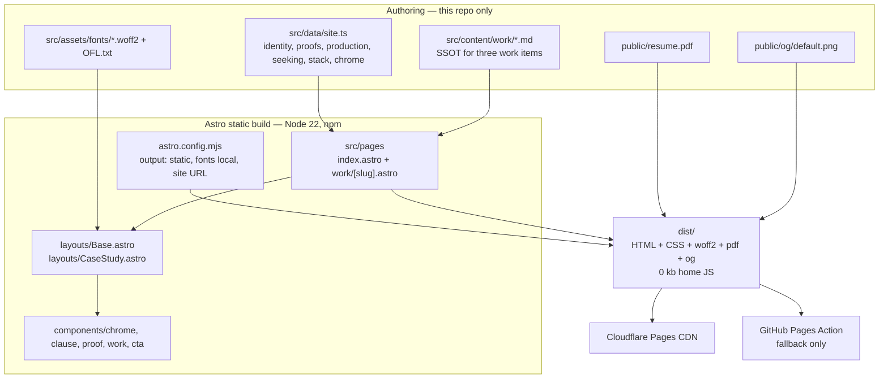
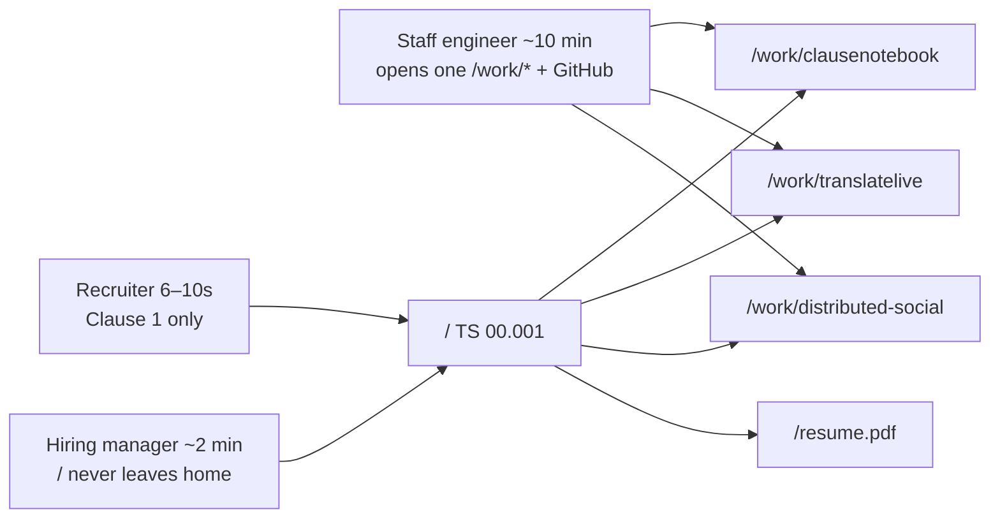
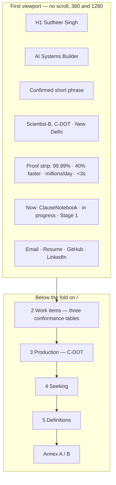
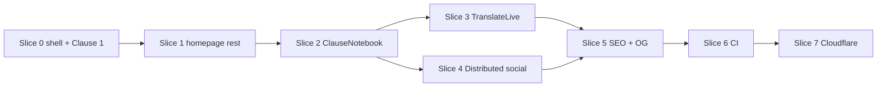

# Design: Sudheer Singh — TS 00.001 Portfolio

| Field | Value |
|---|---|
| **Title** | Sudheer TS 00.001 — Personal engineering portfolio (implementation design) |
| **Author** | Portfolio repo owners |
| **Date** | 2026-09-12 |
| **Status** | Draft (revised after design-review round 1) |
| **Subject** | Sudheer Singh — AI Systems Builder |
| **Repo** | `/Users/tereishqmein/Dev/v2/portfolio` (git init on `main`; research only) |
| **Canonical theme** | TS 00.001 — Standards Document as Product |
| **Art-direction lock** | Paper spec, Plex superfamily, one stamp red, clause-tree navigation, every number cited, no hero illustration, no WebGL, no dots, no orange, no Inter. |

This document is the implementation contract. An engineer should be able to build and browser-test the site slice by slice without inventing visual tokens, routes, copy, or metrics.

### Source precedence (do not reopen)

| Rank | File | Wins on |
|---|---|---|
| 1 | `docs/research/theme-decision.md` (**LOCKED**) | Visual tokens, type, chrome, motion, print, v1 surface, document identity, citations, slice 0, bans |
| 2 | `docs/research/portfolio-ia.md` | Routes, hire-scan order, section copy facts, case-study skeleton, confidentiality, SEO strings, CTA |
| 3 | `docs/research/stack-decision.md` | Astro static, vanilla CSS, CSS-only motion, TypeScript strict, Cloudflare Pages, quality gates |
| 4 | `docs/research/profile-brief.md` | Identity and allowed facts |
| 5 | This file | File paths, component contracts, content types, slice/PR mapping, remaining technical locks |

Theme-decision already resolved the known conflicts (paper not teal; Plex superfamily of three faces / four files; IA reading order; no `/contact`; no form; paper-only v1). This design encodes those resolutions. `theme-nothing.md`, `theme-jdoodle.md`, and `theme-alternatives.md` are background only.

**Documented amendments** (implementation locks where research files disagree; not theme reopenings):

| Topic | Research said | This file locks |
|---|---|---|
| Home H1 vs `<title>` | IA §8.6: H1 matches title `Sudheer Singh — AI Systems Builder` | `<title>` / OG = that string. Visible `h1` = `Sudheer Singh`. Role is a separate line, not inside the `h1`. |
| Font preload | Theme: preload Sans 400 | Preload **Sans 600 only** (H1 is the LCP element). Array API, not boolean `preload`. |
| Stack chips above the fold | IA §2.1 recruiter job lists stack keywords | Slice-0 / PR0 gate does **not** require stack above the fold. Keywords live in clause 5. Do not add a chip row in PR0. |
| Resume CTA timing | This file’s first draft deferred the PDF to PR5 | Copy `public/resume.pdf` in **PR0**. |
| Clause 1 at `<1024` | IA/theme list full role, employer, Now paragraph, running header | Compact strings in §6 (and `site.clause1`). Full strings in `aria-describedby` / `title` / ≥1024. Do not drop `SUDHEER`. |
| Now-line href | IA lists `/work/clausenotebook` on first screen | GitHub only until `publishPage` (PR2). Same rule as `WorkItem`. |
| 360 stamp | Theme: filled stamp, `--stamp-on` type. Contrast table: stamp-on-paper ≥14px | Identity-row class label may be **11px `--stamp` on `--paper`** (5.72:1 ≥ 4.5:1). Filled chip remains ≥14px/600 at ≥1024. |

**Content sync rule:** copy facts into this repo. Do not import `../profile` at build time. The site must build on a machine that does not have `/Users/tereishqmein/Dev/v2/profile`.

---

## Overview

Sudheer Singh is a Scientist-B / backend engineer at C-DOT (Centre for Development of Telematics) in New Delhi, positioning for **AI / LLM engineering roles that own production reliability**. The site must survive three clocks on one artifact: a recruiter’s 6–10 second keep/drop, a hiring manager’s two-minute pitch, and a staff engineer’s ten-minute case-study read.

The product is not a “developer portfolio template.” It is a **productized technical specification** (`SUDHEER TS 00.001`) you can actually read: paper canvas, IBM Plex superfamily, one stamp red, a clause map, conformance tables, and a visible source token on every numeric claim. Four HTML routes plus a static resume PDF. Zero client JavaScript on the homepage until a written exception. Hosted as a static `dist/` on Cloudflare Pages.

This design specifies tokens, routes, components, the TypeScript/Zod content model, copy constraints, incremental slices, quality gates, confidentiality, resume PDF handling, and legal self-hosting of IBM Plex.

---

## Background & Motivation

### Current state

The git repo is empty except `.git` and `docs/`. Research is complete. The theme is locked. There is no application code, no scaffold, and no committed fonts or resume PDF yet.

Identity and proof already exist in the brief and in `../profile/resume/sudheer_cv5_back.md` (CV5). They must be **copied**, not live-imported.

### Why a spec, not a template

2026 junior portfolios converged on dark glass, purple/indigo gradients, Inter, and three equal project cards. That look is a tab-closer for this audience and is on the brief’s avoid-list. Sudheer’s actual work is specification-shaped: NSSAAF interfaces from public 3GPP documents, a provenance-first 3GPP copilot (ClauseNotebook), and production HA numbers that belong in a conformance table, not a testimonial.

### Pain the site must not create

- A recruiter who cannot answer “what does he do / one proof / how to email” without scrolling.
- A staff engineer who opens GitHub and finds the site overclaiming vs the repo (TranslateLive README extras are **out**).
- A leak of C-DOT internals, or the opposite failure: vague “worked on 5G” with no already-public number.
- A frontend-framework demo (React runtime, WebGL, scroll-jack) from a backend/AI engineer.

---

## Goals & Non-Goals

### Goals

1. Ship a static, accessible, printable spec-reader that is a complete 2-minute hire pitch on `/`.
2. Give three systems-thinking case studies permalinks a staff engineer can drop in Slack.
3. Make every numeric claim cited (`[brief]`, `[CV5]`, `[repo]`). Uncited superlatives are a design-system defect.
4. Hit merge gates: Lighthouse mobile **95 / 100 / 100 / 100**, WCAG 2.2 AA, **0 kb JS on home**, fonts ≤ 4 woff2 / ≤ 90 kb.
5. Be buildable in independently testable slices, each reviewable in a browser.

### Non-goals (v1)

- Blog, `/about`, `/skills`, `/contact`, `/now`, `/uses`, `/photos`, `/testimonials`, `/projects`, `/work` index.
- Contact form, Calendly, chatbot, phone in HTML.
- Dark-mode toggle or `prefers-color-scheme` second identity (paper only).
- CMS, SSR adapter, React/Vue/Svelte, Tailwind, GSAP, Framer, WebGL, `ClientRouter`, GA4, Google Fonts CDN.
- Invented employers, metrics, repos, demos, or a GitHub URL for the social backend.
- C-DOT as a fourth case study.
- Headshot, hero illustration, particle field, typing SVG.
- Generating the resume PDF. Copy the existing public file.

---

## Proposed Design

### 1. Product metaphor

The site **is** document `SUDHEER TS 00.001`, version `V1.0.0 (2026-09)`, status `RELEASED`, class `PERSONAL SPECIFICATION`.

Never a fake `3GPP TS 23.xxx` number for this site. No 3GPP, ETSI, or C-DOT logos. No coat of arms. The running header **is** the mark — no logo, no lettermark, no dotted wordmark.

Absorbed principles (zero assets):

| Source | Take | Do not take |
|---|---|---|
| Nothing | Identity is format; spec-sheet information design (tabular proof, units adjacent) | Ndot/NType, Glyph/LED/dots, `#C8102E`/`#ff0033`, OLED field, Shopify fonts |
| JDoodle | Working surface (visitor is already in the document); split for inspectability | Orange Execute, play triangles, Ace/Monaco, STDIN, fake compile, vscode-portfolio |
| Field Instrument (runner-up) | Engraved-metric treatment for the four Clause 1 figures only | Aluminum, screws, amber, teal, Fragment Mono as house face, night-watch palette |
| Citation Ledger (Candidate D) | Visible source tokens on numbers | Magazine masthead, Newsreader, navy cloth, SHA-theatre on non-claims |

### 2. Architecture

Greenfield **static** site. Astro compiles Markdown + `.astro` + `site.ts` into `dist/`. No runtime, no adapter, no islands on v1.





### 3. Theme system

Hex is the contract. Implement in `src/styles/tokens.css` as `oklch(...)` with the hex recorded in a comment. Do not “improve” the palette.

#### 3.1 Color

| Token | Hex | oklch (implement) | Role |
|---|---|---|---|
| `--paper` | `#F3EFE4` | `oklch(0.952 0.015 90.2)` | Page canvas |
| `--paper-2` | `#E8E2D4` | `oklch(0.914 0.020 87.5)` | Inset panels, tables |
| `--ink` | `#1A1916` | `oklch(0.213 0.006 91.6)` | Body, headings, proof numerals |
| `--ink-muted` | `#5C574E` | `oklch(0.459 0.016 82.4)` | Labels, running-header meta |
| `--rule` | `#C4BBA8` | `oklch(0.794 0.028 85.7)` | Hairlines, table rules, clause rail |
| `--stamp` | `#B42318` | `oklch(0.500 0.182 29.5)` | Document-class stamp, availability chip, `:focus-visible`, citation marks |
| `--stamp-on` | `#F3EFE4` | `oklch(0.952 0.015 90.2)` | Type sitting on a stamp fill |

Lab contrast (sRGB relative luminance, verify in browser before merging PR0):

| Pair | Ratio | Gate |
|---|---|---|
| `--ink` on `--paper` | 15.30:1 | Pass AAA body |
| `--ink-muted` on `--paper` | 6.24:1 | Pass AA body (4.5:1). If a browser/OS combo fails, **darken `--ink-muted` only**. Do not lighten `--ink`. Do not switch to teal. |
| `--ink` on `--paper-2` | 13.61:1 | Pass |
| `--ink-muted` on `--paper-2` | 5.55:1 | Pass AA |
| `--stamp` on `--paper` | 5.72:1 | Passes WCAG 1.4.3 normal text (4.5:1) at any size. **Allowed at 11px only for the identity-row class label** `PERSONAL SPECIFICATION` (see amendment). All other stamp-on-paper text stays **≥14px**. |
| `--stamp-on` on `--stamp` | 5.72:1 | Filled chip at ≥1024: ≥14px / 600. Never a large fill. |
| `--rule` on `--paper` | 1.66:1 | **Not text.** Rules and rails only. |

Rules:

- No gradients, no glow, no drop shadows, **0 radius**, **1px hairlines**.
- Stamp red is a rubber stamp on paper — never a large fill, never a value color on OLED black.
- Proof numerals stay `--ink`, never `--stamp`.
- No `prefers-color-scheme` restyle in v1.
- Focus ring: `outline: 3px solid var(--stamp); outline-offset: 2px;` on `:focus-visible` only.

#### 3.2 Type

Legal: IBM Plex Sans, IBM Plex Serif, IBM Plex Mono — SIL OFL 1.1. Reserved Font Names **“IBM Plex” / “Plex”** respected: `@font-face family-name` stays `IBM Plex Sans` / `Serif` / `Mono`. Do not rename a derivative. Self-host woff2. Latin subset. No Google Fonts CDN. No italic until body copy actually uses it.

| Role | Face | Size / leading | Notes |
|---|---|---|---|
| Name / H1 | Plex Sans 600 | 32–40px / 1.1, −0.02em | Sentence case. **Typographic LCP — preload this file.** 32px at 360; 40px at ≥1024. |
| Running header, nav | Plex Sans 400 | 12–14px / 1.3 | Spec controls, not pills |
| Body, short phrase, case prose | Plex Serif 400 | 18–20px / 1.55–1.7 | Measure **66–72ch**. 18px mobile, 20px desktop. |
| Clause IDs, hashes, versions, code | Plex Mono 400 | 12–13px / 1.4 | `font-variant-numeric: tabular-nums` |
| Spec labels | Plex Mono 400 | 11px / 1.2, uppercase, `letter-spacing: 0.08em` | |
| Proof figures | Plex Mono 400 | Hero 32–48px / 1.0; table 14–16px | Ink, not stamp. Tabular nums. **360 compact cells: 28px** (floor exception; 32px at ≥1024). |

CSS variables (set by Astro `<Font />` + tokens):

```css
:root {
  --font-sans: var(--font-plex-sans), "IBM Plex Sans", "Helvetica Neue", Arial, sans-serif;
  --font-serif: var(--font-plex-serif), "IBM Plex Serif", Georgia, serif;
  --font-mono: var(--font-plex-mono), "IBM Plex Mono", ui-monospace, monospace;
}
```

Astro local provider must keep **optimized fallbacks on** so metric-adjusted Arial/Georgia stand-ins hold CLS.

Titles are sentence case. Never all-caps body. Modal verbs (*shall / should / may*) only where true. Do not write the whole site in RFC-speak.

**Home font files (hard cap):** four woff2, ≤ **90 kb** total uncompressed-on-disk of the four files (theme overrides stack’s 3 files / 80 kb). **Preload Sans 600 only** — that is the H1 / LCP face. Do not preload Sans 400, Serif, or Mono. Fontsource latin splits for these four files sum to **81,128 bytes** (Sans 400 22,588 + Sans 600 24,252 + Serif 400 19,580 + Mono 400 14,708). IBM *complete* Sans Regular is 63,020 bytes alone — latin split is mandatory.

#### 3.3 How to legally obtain IBM Plex woff2

Do this in PR0. Commit the four binaries + `OFL.txt`. The build must not fetch fonts from the network at either build or request time.

**Preferred acquisition (official IBM repo, clearest OFL provenance):**

1. Download a release from [github.com/IBM/plex](https://github.com/IBM/plex/releases) (or `npm pack @ibm/plex-sans @ibm/plex-serif @ibm/plex-mono` from the same project).
2. Take **latin / Latin1 split woff2** for:
   - IBM Plex Sans Regular (400)
   - IBM Plex Sans SemiBold (600)
   - IBM Plex Serif Regular (400)
   - IBM Plex Mono Regular (400)
3. Copy `LICENSE.txt` from the IBM repo as `src/assets/fonts/OFL.txt` (SIL OFL 1.1 text, unmodified).
4. Rename for the repo (filenames only — **not** the font family name):

```
src/assets/fonts/ibm-plex-sans-latin-400.woff2
src/assets/fonts/ibm-plex-sans-latin-600.woff2
src/assets/fonts/ibm-plex-serif-latin-400.woff2
src/assets/fonts/ibm-plex-mono-latin-400.woff2
src/assets/fonts/OFL.txt
```

**Allowed alternative (also OFL-1.1, faster):**

```bash
npm pack @fontsource/ibm-plex-sans @fontsource/ibm-plex-serif @fontsource/ibm-plex-mono
# extract each tarball's files/*-latin-400-normal.woff2
# and ibm-plex-sans latin 600
# copy each package's LICENSE / OFL.txt → src/assets/fonts/OFL.txt
```

Fontsource packages are SIL OFL 1.1 (copyright IBM Corp.). After copy, **do not keep `@fontsource/*` as a runtime dependency** — the committed woff2 files are the source of truth so a clean checkout builds offline.

**Forbidden font paths:**

- `fonts.googleapis.com` / `fonts.gstatic.com`
- `fontProviders.google()`
- `fontProviders.fontsource()` as a network provider (even build-time fetch is unnecessary once files are committed)
- Hotlinking IBM’s GitHub raw URLs
- Variable Plex as a fifth/sixth file if it blows the 90 kb budget
- Italic, Condensed, Devanagari, or extra weights

**Wire-up (Astro Fonts API, local provider):**

```js
// astro.config.mjs — sketch, not a scaffold
import { defineConfig, fontProviders } from "astro/config";

export default defineConfig({
  site: "https://sudheer215s.pages.dev", // PR0–PR6 working default; PR7 may replace with a custom domain
  output: "static",
  trailingSlash: "never", // canonical + sitemap without trailing slashes; set CF Pages trailing-slash to none if it 308s
  fonts: [
    {
      name: "IBM Plex Sans",
      cssVariable: "--font-plex-sans",
      provider: fontProviders.local(),
      fallbacks: ["sans-serif"],
      options: {
        variants: [
          { src: ["./src/assets/fonts/ibm-plex-sans-latin-400.woff2"], weight: 400, style: "normal" },
          { src: ["./src/assets/fonts/ibm-plex-sans-latin-600.woff2"], weight: 600, style: "normal" },
        ],
      },
    },
    {
      name: "IBM Plex Serif",
      cssVariable: "--font-plex-serif",
      provider: fontProviders.local(),
      fallbacks: ["serif"],
      options: {
        variants: [
          { src: ["./src/assets/fonts/ibm-plex-serif-latin-400.woff2"], weight: 400, style: "normal" },
        ],
      },
    },
    {
      name: "IBM Plex Mono",
      cssVariable: "--font-plex-mono",
      provider: fontProviders.local(),
      fallbacks: ["monospace"],
      options: {
        variants: [
          { src: ["./src/assets/fonts/ibm-plex-mono-latin-400.woff2"], weight: 400, style: "normal" },
        ],
      },
    },
  ],
});
```

In `Base.astro` — **array preload, never boolean `preload`**. Boolean `preload` on `--font-plex-sans` would emit links for **both** 400 and 600.

```astro
import { Font } from "astro:assets";
<Font cssVariable="--font-plex-sans" preload={[{ weight: 600, style: "normal" }]} />
<Font cssVariable="--font-plex-serif" />
<Font cssVariable="--font-plex-mono" />
```

**LCP font (DevTools):** the home LCP element is `h1` (“Sudheer Singh”) in **IBM Plex Sans 600**. That is the one file that gets `<link rel="preload">`. Running header/nav (Sans 400) and proof numerals (Mono 400) use `font-display: swap` + metric-adjusted fallbacks; they are not preloaded. This amends theme-decision’s “Sans 400 (preload)” because that face is not the LCP element.

`font-display: swap` (Astro default). Measure: `ls -l src/assets/fonts/*.woff2` sum ≤ 90_000 bytes. If over, use IBM’s split Latin1 files (smaller than “complete” woff2). Do not subset with a tool that strips OFL metadata or renames the family.

#### 3.4 Chrome

- **Running header** (every page): painted string is always the full identity `SUDHEER TS 00.001 · V1.0.0 (2026-09) · RELEASED` (see §6). Do **not** drop `SUDHEER` or `(2026-09)`. Sticky.
- **Compact header band at 360** (locked, not “~2.5–3rem”):
  - Row 0 (**32px**): that full identity at **11px** Sans 400 so it fits one line. Stamp is **text** `PERSONAL SPECIFICATION` in `--stamp` on the same row, 11px tracked, `text-overflow: ellipsis` if the row overflows — never a second band, never a large fill. Full stamp string in `title`.
  - Nav wraps to **exactly two rows** of **36px** each (type 12px; hit area 36×36 meets 2.5.8; 44px is required only at ≥768). Row 1: Work · Production · GitHub. Row 2: Resume · Email.
  - Sticky band total: **104px**. Clause headings use `scroll-margin-top: 112px` (band + 8px) so the sticky chrome does not fully hide focused controls (WCAG 2.4.11).
- **≥1024 header:** identity on row 0 (~32px, 12–14px type); filled stamp chip (~24px type 14px/600, `--stamp` fill / `--stamp-on` type) + single-line nav (44px hits) on row 1. Band ~72–88px. `scroll-margin-top: 96px`.
- **Document-class stamp:** `PERSONAL SPECIFICATION` — not a 3GPP/ETSI cover clone. Large fill is forbidden at any breakpoint (theme). 360 uses 11px `--stamp` **text** on `--paper` (amendment; 5.72:1 ≥ 4.5:1). Desktop uses a compact filled chip ≥14px/600.
- **Footer:** `© Sudheer Singh` · git short hash from `src/data/commit.ts` (see Commit SHA below) · IA confidentiality sentence. Repeat visible email, GitHub, LinkedIn, resume.
- **Desktop ≥1024 (PR1+):** left rail **4.5–5.5rem** for clause IDs (`1`, `2.1`, `A`). Rail is `<nav aria-label="Clause map">`. **PR0 `Base.astro` has no rail** — see §5.1.
- **<1024:** no sidebar. Clause ID is a Plex Mono kicker above the heading.
- **Nav labels (IA, hairline, mono):** **Work · Production · GitHub · Resume · Email**.
  - Work → `/#work` (no-op until PR1 ships `#work`; still render the control)
  - Production → `/#production` (no-op until PR1)
  - GitHub → `https://github.com/sudheer215s` (`rel="noopener noreferrer"`, accessible name includes “GitHub”)
  - Resume → `/resume.pdf` (**file exists from PR0**)
  - Email → `mailto:singhsudheer215@gmail.com` with **visible text** `singhsudheer215@gmail.com` in the first screen and footer; nav may use the word `Email` if the first screen already shows the address.
- Case-study pages: highlight **Work** (aria-current). Clause rail (PR1+) lists 2.1 / 2.2 / 2.3 plus a “1 Scope” link back to `/`.
- Status words, honest: `in progress` · `released` · `architecture / personal`. No pulsing live dots. `as of 2026-07` is allowed on dated metrics.
- Space scale: `4 / 8 / 16 / 24 / 32 / 48 / 72` → `--space-1` … `--space-7`.
- Max measure for prose: 72ch. Do not stretch body text on 1440+.

**Commit SHA (PR0, not PR7).** `src/data/commit.ts` is imported only from `.astro` frontmatter (build time):

```ts
import { execSync } from "node:child_process";

function resolveCommitSha(): string {
  const fromEnv =
    process.env.CF_PAGES_COMMIT_SHA ??
    process.env.GITHUB_SHA ??
    process.env.PUBLIC_COMMIT_SHA;
  if (fromEnv) return fromEnv.slice(0, 7);
  try {
    return execSync("git rev-parse --short HEAD", {
      encoding: "utf8",
      stdio: ["ignore", "pipe", "ignore"],
    }).trim();
  } catch {
    return "dev";
  }
}

export const commitSha = resolveCommitSha();
```

Cloudflare Pages injects `CF_PAGES_COMMIT_SHA` at build. GitHub Actions injects `GITHUB_SHA`. Local preview prints `dev` if git is unavailable. Declare nothing on `ImportMetaEnv` unless a `vite.define` path is used instead; the module export is sufficient. Footer renders `commitSha`. Do not hardcode `V1.0.0` in place of the hash (version stays in the running header).

#### 3.5 Motion

CSS only. Default: **none**, except 150–200ms `ease-out` color/opacity on hover/focus of rules and links. `:target` highlight on clause jump (background `--paper-2`, no animation required).

```css
@media (prefers-reduced-motion: reduce) {
  *, *::before, *::after {
    animation: none !important;
    transition: none !important;
    scroll-timeline: none;
  }
}
```

Forbidden: count-up, Ken Burns, scroll-jack, Lenis, Locomotive, AOS, view-transition in v1, motion required for meaning. Scroll-driven CSS only inside `@supports (animation-timeline: view())` and never as the only way to reveal content (paint the final state first).

#### 3.6 Print

`@media print` must produce a readable spec:

- Hide sticky header duplication if it repeats on every page; keep document identity once at the top.
- Hide skip link, external-icon flourishes.
- Ink on paper (or white). Stamp red may stay for the class banner.
- Expand `a[href]::after { content: " (" attr(href) ")"; }` for external links; skip for fragment links.
- Allow page breaks between clauses, not inside a proof cell.
- Body in Plex Serif; headers persist as print running titles via `@page` where supported.

#### 3.7 Accessibility (theme-level)

See § Observability for the full gate table. Theme-specific:

- One `h1` per page. **Home:** visible `h1` = `Sudheer Singh` (name only). Role is the next line, not inside the `h1`. **`<title>` and OG title** remain `Sudheer Singh — AI Systems Builder` (IA §8.6). This is a recorded amendment, not a silent override. **Case studies:** `h1` = IA title.
- Heading outline **is** the clause tree.
- Skip link is the first focusable control, targets `#main`.
- Clause map is a nav, not a decoration.
- 200% zoom, no horizontal scroll at 320px except wide tables wrapped in a noted overflow region.
- Targets ≥ 24×24 CSS px (prefer 44×44). Nav hit area can exceed the 12px type. At 360, nav rows are **36px** (still ≥24). At ≥768, prefer 44px.
- `html lang="en"`.

#### 3.8 Stylesheets and `@layer` (PR0 wiring)

One entry file. `Base.astro` imports only `src/styles/entry.css`. Layer names:

```css
/* src/styles/entry.css */
@layer reset, tokens, base, components, utilities;

@import "./reset.css" layer(reset);
@import "./tokens.css" layer(tokens);
@import "./base.css" layer(base);
@import "./chrome.css" layer(components);
@import "./motion.css" layer(utilities);
@import "./print.css"; /* unlayered, after the layer list, so @media print always wins */
```

| File | Layer | Ships in | Owns |
|---|---|---|---|
| `reset.css` | `reset` | PR0 | box-sizing, margin 0, list style |
| `tokens.css` | `tokens` | PR0 | color, type, space custom properties |
| `base.css` | `base` | PR0 | `html`/`body` paper canvas, heading/body families, landmarks, `scroll-margin-top` |
| `chrome.css` | `components` | PR0 | header, stamp, nav, footer, skip link, proof cells, CTA, `ClauseHeading` |
| `clauses.css` | `components` | **PR1** | clause rail, `.document` two-column, work tables, production/seeking/definitions |
| `motion.css` | `utilities` | PR0 | hover/focus 150–200ms, `:target`, reduced-motion kill switch |
| `print.css` | unlayered | PR0 | `@media print` |

There is no `utilities.css`. There is no `global.css`. Scoped `<style>` in `.astro` files are additional `components`-level rules; they must not redeclare tokens. PR0 `Clause.astro` / `ClauseHeading.astro` style via `chrome.css` + scoped CSS; `clauses.css` waits for the rail.

### 4. Exact routes and homepage clause map

Four HTML routes + one file. **No other pages.**

```
/                         homepage — 2-minute pitch
/work/clausenotebook      clause 2.1 expanded
/work/translatelive       clause 2.2 expanded
/work/distributed-social  clause 2.3 expanded
/resume.pdf               static file, not a page
```

`/work` without a slug **404s** (branded `src/pages/404.astro` from PR0: `Base` + “Clause not found.”). `/contact`, `/projects`, `/about`, `/blog` **404**. Do not add redirects that invent IA.

Theme Candidate A listed C-DOT before work. **Rejected.** Hire-scan needs the three work items immediately after the first screen (`portfolio-ia.md` §4.1). Clause numbers are chrome on IA sections; they do not add routes and they do not reorder the page.

| Clause | Fragment | IA section | Content |
|---|---|---|---|
| **1 Scope** | (first viewport; optional `#scope`) | First screen | Name, role, short phrase, C-DOT title, four-metric proof strip, ClauseNotebook now-line, CTA |
| **2 Work items** | `#work` | Selected work | 2.1 ClauseNotebook · 2.2 TranslateLive · 2.3 Distributed Social Media Backend |
| **3 Production** | `#production` | C-DOT | Resume-public facts only |
| **4 Seeking** | `#seeking` | Looking for / will not do | + education one-liner |
| **5 Definitions** | `#stack` | Stack | Tools he actually uses; no bars |
| **Annex A** | footer | Contact | Visible email + links |
| **Annex B** | footer meta | Change history | git short hash |



Desktop ≥1024 layout:

```
┌──────────────────────────────────────────────────────────────┐
│ SUDHEER TS 00.001 · V1.0.0 (2026-09) · RELEASED              │
│ PERSONAL SPECIFICATION          Work · Production · GitHub · │
│                                 Resume · Email               │
├─────────┬────────────────────────────────────────────────────┤
│ 1       │ 1 Scope                                            │
│ 2       │   Sudheer Singh                                    │
│  2.1    │   AI Systems Builder                               │
│  2.2    │   “AI engineer with three years…”                  │
│  2.3    │   [ four engraved proof cells ]                    │
│ 3       │   Now: ClauseNotebook …                            │
│ 4       │   singhsudheer215@gmail.com                        │
│ 5       │ 2 Work items                                       │
│ A       │ 3 Production                                       │
│ B       │ …                                                  │
└─────────┴────────────────────────────────────────────────────┘
```

#### 4.1 Responsive proof-cell contract (PR0, merge-blocking)

Locked **detail** strings in §6 and in `proofs[].detail` are never paraphrased. They are also never all painted in the 360 first viewport.

| Viewport | `ProofCell` paints | Detail strings |
|---|---|---|
| **<1024** | `value` + `qualifier` + citation tokens only (e.g. `99.99%` / `uptime` `[brief][CV5]`) | Same `detail` in `aria-describedby` (visually hidden clip, **not** `display:none`) and `title`. Visible again in `#production` (PR1) and the relevant case study. |
| **≥1024** | Engraved four-cell strip with `value`, `qualifier`, **full `detail`**, citations | Visible in the cell. |

Compact numerals at 360: **28px** Mono (exception to the 32px hero floor; 32px returns at ≥1024). Qualifier: 11px Mono uppercase. 2×2 grid, 0 radius, 1px `--rule`. No count-up.

Availability chip (“Open to AI / LLM…”) renders only at **≥1024**. Dropped at 360 — it is the only droppable slot; do not drop email, a proof numeral, or the phrase.

IA §2.1 “stack keywords above the fold” is **not** a PR0 gate. Python / FastAPI / PostgreSQL / RAG / Kubernetes / TypeScript live in clause 5 (`#stack`). Do not add a chip row in PR0. If a later PR wants one keyword line, it must be a locked string in `site.ts`, not a bar.

#### 4.2 360×640 first-viewport wireframe (heights sum ≤640)

Padding horizontal 16px. Skip link off-screen until focused (0px). **Every painted string is the §6 compact column** (also `site.clause1`). This drawing is a height check, not a paraphrase.

```
┌─────────────────────────────────────┐  360 × 640
│ SUDHEER TS 00.001 · V1.0.0 (2026-09)│  32px  §6 compact identity at 11px
│ · RELEASED     PERSONAL SPECIFIC…   │        stamp 11px --stamp, same row, ellipsis OK
│ Work · Production · GitHub          │  36px  nav row 1
│ Resume · Email                      │  36px  nav row 2
├─────────────────────────────────────┤  --- sticky band 104px ---
│ 1  SCOPE                            │  16px  kicker
│ Sudheer Singh                       │  36px  h1 32px/1.1 Sans 600  ← LCP
│ AI Systems Builder                  │  20px  §6 compact role
│ AI engineer with three years        │  84px  full phrase 18px/1.55 ≈3 lines
│ building high-availability backends │
│ for India's national telecom…       │
│ Scientist-B, C-DOT · New Delhi      │  20px  §6 compact employer
│ ┌──────────────┐ ┌──────────────┐   │
│ │ 99.99%       │ │ 40%          │   │ 104px  §6 compact proofs
│ │ uptime [.]   │ │ faster [.]   │   │
│ ├──────────────┤ ├──────────────┤   │
│ │ Millions/day │ │ <3s          │   │
│ │ lookups [.]  │ │ e2e [.]      │   │
│ └──────────────┘ └──────────────┘   │
│ Now: ClauseNotebook · in progress   │  32px  §6 compact Now (2 lines)
│ · Stage 1  (GitHub, not /work/…)    │
│ singhsudheer215@gmail.com           │  24px  visible mailto
│ Resume · GitHub · LinkedIn          │  28px  CTA row
└─────────────────────────────────────┘
Blocks: 32+36+36+16+36+20+84+20+104+32+24+28 = 468px
Gaps (~8px × 8) + phrase wrap slack: ~64–96px
Ceiling: 468+96 = 564px  ≤ 640px
```

Identity row still **104px band total** with nav: the two identity ASCII lines are one 32px CSS row (11px type). Do **not** give the stamp its own 24–32px row. Now compact is two 16px lines = 32px, GitHub only (Issue 2 / §6).

If the phrase wraps to four lines (+28px) the composition is still ≤640. If it still overflows, shrink compact numerals to 24px **before** dropping a proof cell or email. Do not shrink below 24px. Do not add a photo. Do not shorten `SUDHEER TS 00.001 · V1.0.0 (2026-09) · RELEASED`.

1280 first viewport uses the desktop strip with **details visible** and a single-line nav; vertical budget is not the constraint there.

### 5. Component tree and file paths

Reconcile `stack-decision.md` §4 with IA/theme: **no** `src/pages/contact.astro`, **no** `src/pages/projects/**`, **no** `src/pages/work/index.astro`, **no** `ContactForm.astro`.

```
portfolio/
  astro.config.mjs
  tsconfig.json                    # extends astro/tsconfigs/strict
  package.json                     # engines.node: "22"
  package-lock.json
  .nvmrc                           # 22
  README.md                        # run, test, deploy, content-sync
  public/
    favicon.svg                    # paper rect + stamp "TS"; not a lettermark brand
    robots.txt                     # PR5
    resume.pdf                     # PR0 (copy of CV5 PDF)
    og/default.png                 # PR5, 1200×630 typographic PNG, committed
    _headers                       # PR7 Cloudflare cache + security headers
  src/
    env.d.ts
    content.config.ts              # Zod collections — PR1 (SSOT for work items)
    assets/
      fonts/
        ibm-plex-sans-latin-400.woff2
        ibm-plex-sans-latin-600.woff2
        ibm-plex-serif-latin-400.woff2
        ibm-plex-mono-latin-400.woff2
        OFL.txt
      images/                      # empty in v1 unless a real screenshot exists
      icons/                       # inline SVG only if needed (none required)
    content/
      work/                        # PR1 frontmatter; bodies authored PR2–PR4
        clausenotebook.md
        translatelive.md
        distributed-social.md
    data/
      site.ts                      # identity, proofs, production, seeking, stack, chrome — not work items
      citations.ts                 # token → bibliographic string
      commit.ts                    # PR0: git short hash for footer
    styles/
      entry.css                    # the only stylesheet Base imports
      reset.css
      tokens.css
      base.css
      chrome.css
      clauses.css                  # PR1
      motion.css
      print.css
    layouts/
      Base.astro
      CaseStudy.astro
    components/
      chrome/
        SkipLink.astro
        RunningHeader.astro
        Stamp.astro
        Nav.astro
        ClauseRail.astro           # PR1 — not in Base in PR0
        Footer.astro
      clause/
        Clause.astro
        ClauseHeading.astro
      proof/
        ProofStrip.astro
        ProofCell.astro
        Citation.astro
      work/
        WorkList.astro
        WorkItem.astro             # conformance table, not a card
        ConformanceTable.astro
      production/
        ProductionBlock.astro
      seeking/
        SeekingBlock.astro
      definitions/
        Definitions.astro
      cta/
        CtaCluster.astro
      figures/
        TranslateLiveSequence.astro  # PR3; SVG, brief facts only
    pages/
      index.astro
      404.astro                    # PR0; Base + “Clause not found.”
      work/
        [slug].astro               # PR2; only entries with publishPage: true
    scripts/                       # empty until an island is justified
  tests/
    visual/                        # PR6
    a11y/                          # PR6
    copy/                          # PR6 forbidden-string lint
  .github/
    workflows/
      ci.yml                       # PR6: a11y + lighthouse + copy lint
      pages.yml                    # PR7: GH Pages fallback
```

**Do not create:** `src/pages/api/`, `src/middleware.ts`, `src/components/ui/`, `tailwind.config.*`, `src/pages/contact.astro`, `src/pages/projects/`, `src/components/contact/`.

#### 5.1 Layout contracts

**`Base.astro` — two shapes, one file, no stub rail**

PR0 omits `ClauseRail`. PR1 adds it and the `.document` two-column shell. Do not ship a no-op rail in PR0.

- `<html lang="en">`
- Head: charset, viewport, title/description slots, canonical, `<Font>` array preload (Sans 600 only), `import "../styles/entry.css"`, favicon.
- **PR0 body:** `SkipLink` → `header` (RunningHeader + Stamp + Nav) → `<main id="main" tabindex="-1">` slot → `Footer`.
- **PR1+ body:** `SkipLink` → `header` → `<div class="document">` (`ClauseRail` + `<main id="main" tabindex="-1">`) → `Footer`.
- Wrap the rail in `{rail && …}` or a `showRail` prop defaulting to `false` in PR0 and flipped in PR1. `CaseStudy.astro` (PR2) always passes `showRail`.
- No client JS. No images in the chrome.

**`CaseStudy.astro`** extends Base:

- Sets `aria-current` on Work.
- Slot 1: conformance table (desktop ≥1024: table in a `--paper-2` inset beside the one-paragraph claim; mobile: table stacked above narrative).
- Slot 2: Markdown body rendered as clauses 1–6 of the IA skeleton.
- Back link: `← 2 Work items` to `/#work`.

#### 5.2 Critical component interfaces

```ts
// Citation is the only way a number appears in the DOM.
type CitationToken = "brief" | "CV5" | "repo";

interface CitationProps {
  tokens: readonly CitationToken[];
  // Accessible text, e.g. "Source: brief, CV5"
}

interface ProofCellProps {
  value: string;          // "99.99%" — numeral first
  qualifier: string;      // "uptime"
  detail: string;         // already-public clause; no invented p95
  citations: readonly CitationToken[];
  // Compact vs full is CSS (@media 1024), not a JS prop. Always pass detail.
}

interface ClauseProps {
  id: string;             // "work" | "production" | ...
  number: string;         // "1" | "2.1" | "A"
  title: string;          // "Scope" | "Work items"
  children?: import("astro").Snippet; // default slot; never `any`
}

interface WorkItemProps {
  // One collection entry. Home and case study read the same object.
  entry: CollectionEntry<"work">;
}
```

`Citation.astro` renders a Plex Mono bracket token in `--stamp`, e.g. `[brief][CV5]`. The characters are real text (not CSS `content:` only) so they copy/print/announce. Title/aria: “Source: subject brief; CV5”.

`ProofStrip.astro` is a list (`<ul>`) of four `ProofCell`s from `proofs` where `surfaces` includes `"hero"`. Engraved-metric treatment = hairline box, 0 radius, numeral in Plex Mono, unit adjacent, no count-up. Compact vs full is the §4.1 media query.

`WorkItem.astro` **is not a card**. It is a numbered subclause plus `ConformanceTable.astro` with rows: problem, constraint, stack, proof, repo, status — all from `CollectionEntry<"work">`. Proof row looks up `proofs` by `entry.data.proofIds`; it does not retype numerals. “Case study” href is rendered only when `entry.data.publishPage` is true (otherwise GitHub if `repo`, else the write-up line with no dead link).

### 6. Homepage Clause 1 — locked first-viewport copy

Builder cannot invent strings. At `<1024` paint the **compact** column; put the **full** column in `aria-describedby` / `title` (visually hidden clip, not `display:none`) and paint it at **≥1024**. These exact values live in `site.clause1` (PR0). The §4.2 wireframe is a height check of the compact column — not a second copy deck.

| Slot | Compact (`<1024`, painted) | Full (`≥1024` painted; always in `aria-describedby` / `title`) |
|---|---|---|
| Running header | `SUDHEER TS 00.001 · V1.0.0 (2026-09) · RELEASED` (11px, one line; **do not drop `SUDHEER`**) | Same string (12–14px) |
| Stamp | `PERSONAL SPECIFICATION` (11px `--stamp` on `--paper`, same row; ellipsis if needed) | Filled chip, ≥14px/600, `--stamp-on` on `--stamp` |
| Name / H1 | Sudheer Singh | Sudheer Singh |
| Role | `AI Systems Builder` | `AI Systems Builder — backend engineer for AI-powered products.` |
| Short phrase | Full phrase (may wrap 3–4 lines) | Same |
| Employer | `Scientist-B, C-DOT · New Delhi` | `Scientist-B / Backend Engineer, C-DOT (Centre for Development of Telematics)` |
| Location | Folded into compact employer | `New Delhi, India` (own line or trailing the full employer line) |
| Proof 1 | `99.99%` / `uptime` `[brief][CV5]` | Compact plus detail: PostgreSQL primary-replica cluster, streaming replication + auto-failover; sub-30s recovery; zero unplanned outages since launch |
| Proof 2 | `40%` / `faster` `[brief][CV5]` | Compact plus detail: critical IMS/ENUM queries under peak load (query-plan analysis + index redesign) |
| Proof 3 | `Millions / day` / `lookups` `[brief][CV5]` | Compact plus detail: national IMS/ENUM subscriber lookups, sub-second |
| Proof 4 | `<3s` / `e2e` `[brief][CV5]` | Compact plus detail: TranslateLive STT → GPT translation → TTS, end-to-end |
| Now | `Now: ClauseNotebook · in progress · Stage 1` | `Building ClauseNotebook — citation-grounded 3GPP standards copilot. Status: in progress. Ingestion (versioned JSON manifest, SHA-256, idempotent CLI) works today; retrieval is next.` |
| Now links | **GitHub only:** `https://github.com/sudheer215s/ClauseNotebook` until `publishPage` | Same GitHub link. Add `/work/clausenotebook` **when PR2 sets `publishPage: true`** on `clausenotebook.md`. Never href a 404. |
| CTA | Visible `singhsudheer215@gmail.com` · `/resume.pdf` · `https://github.com/sudheer215s` · `https://linkedin.com/in/sudheer-singh-975889195` | Same |
| Optional chip | **Not painted** | `Open to AI / LLM engineering roles that own production reliability.` |

First viewport on 360 and 1280 **without scrolling** must still contain: name, compact or full role, phrase, compact or full employer, four proof **numerals + qualifiers**, compact or full now-line, email. Stack keywords are **not** in this viewport (clause 5). Follow the §4.2 wireframe using **this table’s compact column**; do not invent a fifth drop rule. Do not add a photo.

---

## API / Interface Changes

There is no HTTP API. The “API” is the component + content-collection contract.

### Astro config contract

| Key | Value |
|---|---|
| `output` | `'static'` |
| Adapter | none |
| `site` | `https://sudheer215s.pages.dev` from PR0; PR7 changes this only if a custom domain exists |
| `trailingSlash` | `'never'` |
| `base` | `'/'` (custom domain or Pages root; if GH Pages fallback is `username.github.io/portfolio`, set `base` only in that workflow) |
| Integrations v1 | `@astrojs/sitemap` from PR5. No MDX, no React, no Tailwind. |
| Node | **22 LTS** — `.nvmrc` contains `22`; `package.json` `"engines": { "node": "22" }` |
| Package manager | npm + `package-lock.json` |

Pin `astro` to “latest stable at scaffold time.” Do not pin a minor in this document that will rot.

### Content collection contract

```ts
// src/content.config.ts
import { defineCollection, z } from "astro:content";
import { glob } from "astro/loaders";

const work = defineCollection({
  loader: glob({ pattern: "*.md", base: "./src/content/work" }),
  schema: z.object({
    slug: z.enum(["clausenotebook", "translatelive", "distributed-social"]),
    clause: z.enum(["2.1", "2.2", "2.3"]),
    name: z.string(),                  // "ClauseNotebook"
    title: z.string(),                 // IA §5 titles, outcome not "My Project"
    status: z.enum(["in-progress", "released", "architecture"]),
    statusLabel: z.string(),           // e.g. "In progress · Stage 1 ingestion"
    role: z.literal("Solo, personal"),
    datesNote: z.string(),
    repo: z.string().url().nullable(), // null for social backend
    demo: z.literal(null),             // v1: never a URL
    stack: z.array(z.string()).min(3).max(10),
    problem: z.string(),               // one or two sentences for the home table
    constraint: z.string(),            // one or two sentences for the home table
    line: z.string(),                  // home one-line outcome
    claim: z.string(),                 // golden ~150-word stand-alone opening (see § Case-study openings)
    proofIds: z.array(z.string()),     // keys into proofs[] in site.ts; never retype numerals
    proofNote: z.string().optional(),  // non-numeric proof (e.g. “public repo is the artifact”)
    publishPage: z.boolean(),          // false in PR1; flipped true when the case-study body ships
    seoDescription: z.string().max(160),
  }),
});

export const collections = { work };
```

**SSOT:** the work collection is the only source for the three work items. `site.ts` does **not** contain `workIndex`. Home `WorkList` calls `getCollection("work")` from **PR1** (when `content.config.ts` and the three frontmatter files land). Case-study pages use the same objects. PR2 must not fork copy back into `index.astro`.

`src/pages/work/[slug].astro` (PR2): `getCollection("work", ({ data }) => data.publishPage)`. If a fourth markdown file is added without updating the enum, the build must fail. `demo` is locked to `null`.

Markdown body **must** use this heading skeleton (IA §5), typeset as spec subclauses:

```
## 1. Problem
## 2. Constraints
## 3. Design
## 4. Proof
## 5. What I would do next
## 6. What this is not
```

Length target: **600–900 words**, **authored** in PR2–PR4 from the locked facts below — not transcribed from this design. The golden `claim` frontmatter field *is* the first ~150 words and must stand alone.

### Page → data wiring

| Page | Reads |
|---|---|
| `/` | `site.ts` for clauses 1, 3, 4, 5, annexes. Clause 2: `getCollection("work")` only. |
| `/work/[slug]` | One collection entry (`publishPage: true`) + `site.ts` for chrome, CTAs, `proofs` lookup. Markdown body must not retype numerals that exist in `proofs`. |

### `getStaticPaths`

Three paths only. Unknown slugs 404.

---

## Data Model Changes

No database. The data model is TypeScript modules + Zod collections.

### `src/data/site.ts` — identity, proofs, production, seeking, stack

Copy from the brief + IA + CV5. **Never** `fs.readFile('../profile/...')`. Work items live in the collection, not here.

```ts
export const citationTokens = ["brief", "CV5", "repo"] as const;
export type CitationToken = (typeof citationTokens)[number];

export const site = {
  document: {
    id: "SUDHEER TS 00.001",
    version: "V1.0.0",
    versionDate: "2026-09",
    status: "RELEASED",
    stamp: "PERSONAL SPECIFICATION",
  },
  person: {
    name: "Sudheer Singh",
    role: "AI Systems Builder",
    roleLine: "AI Systems Builder — backend engineer for AI-powered products.",
    shortPhrase:
      "AI engineer with three years building high-availability backends for India's national telecom infrastructure.",
    location: "New Delhi, India",
    email: "singhsudheer215@gmail.com",
    github: "https://github.com/sudheer215s",
    linkedin: "https://linkedin.com/in/sudheer-singh-975889195",
    // Phone exists on the PDF resume only. Do not add a phone field that gets rendered.
  },
  clause1: {
    identity: "SUDHEER TS 00.001 · V1.0.0 (2026-09) · RELEASED",
    stamp: "PERSONAL SPECIFICATION",
    roleCompact: "AI Systems Builder",
    roleFull:
      "AI Systems Builder — backend engineer for AI-powered products.",
    employerCompact: "Scientist-B, C-DOT · New Delhi",
    employerFull:
      "Scientist-B / Backend Engineer, C-DOT (Centre for Development of Telematics)",
    location: "New Delhi, India",
    nowCompact: "Now: ClauseNotebook · in progress · Stage 1",
    nowFull:
      "Building ClauseNotebook — citation-grounded 3GPP standards copilot. Status: in progress. Ingestion (versioned JSON manifest, SHA-256, idempotent CLI) works today; retrieval is next.",
    nowGithub: "https://github.com/sudheer215s/ClauseNotebook",
    nowCaseStudy: "/work/clausenotebook", // render only if clausenotebook.publishPage
  },
  employer: {
    name: "C-DOT",
    legalName: "Centre for Development of Telematics",
    ministry: "Ministry of Communications",
    titleCurrent: "Scientist-B / Backend Engineer",
    datesCurrent: "Jul 2024 – present",
    titlePrior: "Research Engineer",
    datesPrior: "Jul 2023 – Jun 2024",
  },
  education: {
    line: "B.Tech CSE, MANIT Bhopal, 2019–2023",
    // No CGPA. No JEE. No Class 12.
  },
  seo: {
    title: "Sudheer Singh — AI Systems Builder",
    description:
      "Backend engineer for AI-powered products. Three years on India’s national telecom infrastructure — 99.99% uptime, 40% faster lookups. Building citation-grounded RAG for 3GPP.",
  },
  availability:
    "Open to AI / LLM engineering roles that own production reliability.",
  confidentiality:
    "C-DOT production details on this site are limited to facts already on my public resume. I don’t publish internal architecture.",
} as const;

export const proofs = [
  {
    id: "uptime",
    value: "99.99%",
    qualifier: "uptime",
    detail:
      "PostgreSQL primary-replica cluster, streaming replication + auto-failover; sub-30s recovery; zero unplanned outages since launch",
    citations: ["brief", "CV5"] as const,
    surfaces: ["hero", "production"] as const,
  },
  {
    id: "query",
    value: "40%",
    qualifier: "faster",
    detail:
      "critical IMS/ENUM queries under peak load (query-plan analysis + index redesign)",
    citations: ["brief", "CV5"] as const,
    surfaces: ["hero", "production"] as const,
  },
  {
    id: "lookups",
    value: "Millions / day",
    qualifier: "lookups",
    detail: "national IMS/ENUM subscriber lookups, sub-second",
    citations: ["brief", "CV5"] as const,
    surfaces: ["hero", "production"] as const,
  },
  {
    id: "translate-e2e",
    value: "<3s",
    qualifier: "e2e",
    detail: "TranslateLive STT → GPT translation → TTS, end-to-end",
    citations: ["brief", "CV5"] as const,
    surfaces: ["hero", "translatelive"] as const,
  },
  {
    id: "translate-sessions",
    value: "10+",
    qualifier: "sessions",
    detail:
      "simultaneous WebSocket sessions without dropped connections (load tests)",
    citations: ["CV5"] as const,
    surfaces: ["translatelive"] as const,
  },
] as const;

export const productionFacts = {
  framing:
    "He owns backend for India’s national IMS/ENUM call-routing service. A dropped lookup is a call that never connects. This block is credibility for the AI work, not the headline.",
  transfer:
    "Retries, backpressure, tail latency, and instrumentation are the same problems whether the thing in the middle is a database or a model.",
  nssaafDisplay:
    "NSSAAF 5G-core service interfaces from 3GPP TS 23.501 (stage 2) and the NSSAAF stage-3 service API.",
  nssaafFootnote:
    "CV5 lists TS 29.509 alongside TS 23.501. TS 29.509 specifies AUSF. NSSAAF stage-3 may be TS 29.526; I will not guess. This site does not print 29.509 as NSSAAF stage-3.",
  bullets: [
    {
      text: "National IMS/ENUM call-routing backend: millions of subscriber lookups/day, sub-second.",
      citations: ["brief", "CV5"] as const,
    },
    {
      text: "PostgreSQL primary-replica cluster he rebuilt: streaming replication + auto-failover, 99.99% uptime, sub-30s recovery, zero unplanned outages since launch.",
      citations: ["brief", "CV5"] as const,
    },
    {
      text: "40% faster critical IMS/ENUM queries under peak load via query-plan analysis + index redesign.",
      citations: ["brief", "CV5"] as const,
    },
    {
      text: "Monitoring/alerting reduced detection from user reports to minutes.",
      citations: ["brief", "CV5"] as const,
    },
    {
      text: "Number Portability Server on SS7/SIGTRAN.",
      citations: ["brief", "CV5"] as const,
    },
    {
      text: "First-submission compliance, zero non-conformances.",
      citations: ["brief", "CV5"] as const,
    },
    {
      text: "Deployment automation (Python + Bash) cut manual effort 70%.",
      citations: ["brief", "CV5"] as const,
    },
    {
      text: "Closed 3 auth gaps from an internal security audit.",
      citations: ["brief", "CV5"] as const,
    },
    {
      text: "Research-engineer year (Jul 2023 – Jun 2024): Ubuntu Linux + PostgreSQL for live telecom services, 99.9% availability throughout the year.",
      citations: ["CV5"] as const,
      dated: "2023–24",
    },
  ],
} as const;

export const seeking = {
  lookingFor:
    "An AI / LLM engineering role building LLM-powered products end to end and owning the production layer — retrieval and RAG, agentic workflows, evals, tracing. Drawn to developer tools, AI infrastructure, and applied AI over technical corpora (including telecom). Wants shorter feedback loops than a government R&D lab: shipping in weeks.",
  avoiding:
    "Prompt-tweaking by feel with no evals or traces; thin wrapper work; AI that stops at the prototype; teams where shipping speed consistently wins over testing and reliability.",
} as const;

export const stack = {
  languages: ["Python", "TypeScript", "SQL", "Bash"],
  backend: ["FastAPI", "NestJS", "Node.js"],
  data: ["PostgreSQL", "Redis", "Elasticsearch", "Kafka"],
  infra: ["Docker", "Kubernetes", "Linux", "CI/CD", "Prometheus/Grafana"],
  llm: ["LangGraph/LangChain", "RAG", "evals", "Langfuse", "OpenTelemetry"],
  llmCaveat:
    "Listed as tools in use. This site does not claim a shipped LangGraph/Langfuse product. Evidence is TranslateLive (GPT in a pipeline) and ClauseNotebook (ingestion).",
} as const;
```

Home proof strip: `proofs.filter((p) => p.surfaces.includes("hero"))` — four cells. Do not add a fifth.

`src/data/citations.ts` maps tokens to human strings:

| Token | Means |
|---|---|
| `brief` | Subject brief (positioning confirmed 2026-07-09) |
| `CV5` | Public resume `sudheer_cv5_back` |
| `repo` | Public GitHub repository named on that page |

### Proof-number table (do not exceed)

Copied from IA §5.4. The site **may not** print a number that is not in this table.

| Claim | Surfaces | Do not upgrade to |
|---|---|---|
| millions of subscriber lookups/day, sub-second | Hero, production, resume | Exact QPS, national subscriber census |
| 99.99% uptime; sub-30s recovery; zero unplanned outages since launch | Hero, production | Five-nines, RPO=0, sync-replication |
| 40% faster critical IMS/ENUM queries under peak load | Hero, production | p95 milliseconds |
| detection from user reports → minutes | Production | MTTD in seconds, alert rules |
| 70% less manual deployment/config effort | Production | Hours saved |
| 3 auth gaps closed (internal audit) | Production | CVE IDs, gap descriptions |
| first-submission compliance, zero non-conformances | Production | “external validator” |
| 99.9% availability (research-engineer year) | Production, dated 2023–24 | Mix with 99.99% |
| <3s TranslateLive e2e | Hero, TranslateLive | Per-stage ms table from README |
| 10+ concurrent WS sessions, no drops | TranslateLive | 50+ users, 100 meetings/cluster |
| SHA-256, idempotent CLI, registered→converted | ClauseNotebook | Recall@5, grounded-answer pass rate |

### Case-study frontmatter + body (locked facts)

PR1 ships all three markdown files with **frontmatter complete** and an empty or one-line body (`publishPage: false`). Home tables render. PR2–PR4 are **authoring PRs**: write 600–900 words from these facts (share-answers language allowed where IA already compressed it). They are not transcription of this design into HTML. Flip `publishPage: true` in the same PR as the body.

Home conformance rows (PR1) use `problem`, `constraint`, `stack`, `proofIds`/`proofNote`, `repo`, `statusLabel` from frontmatter.

**`clausenotebook.md`** — paste this frontmatter (PR1). `claim` is the golden paragraph below. `publishPage: false` until PR2.

```yaml
slug: clausenotebook
clause: "2.1"
name: ClauseNotebook
title: Provenance-first ingestion for a citation-grounded 3GPP copilot
status: in-progress
statusLabel: In progress · Stage 1 ingestion
role: Solo, personal
datesNote: In progress. Stage 1 ingestion. Solo, personal. Public 3GPP PDFs only.
repo: https://github.com/sudheer215s/ClauseNotebook
demo: null
stack: [Python, CLI, JSON, SHA-256, PyMuPDF4LLM]
problem: Engineers need the exact clause that specifies a requirement across large, versioned 3GPP documents; a confident paraphrase with no citation is a liability.
constraint: Public 3GPP PDFs only; reproducible SHA-256 citations; idempotent registration; no chat UI until retrieval can abstain.
line: Citation-grounded 3GPP copilot. Provenance first: versioned JSON manifest, SHA-256, idempotent CLI, PyMuPDF4LLM, registered → converted. Next: clause-aware chunking, hybrid retrieval, inline citations, abstention.
proofIds: []
proofNote: Stage 1 CLI + public repo; no Recall@k.
publishPage: false
seoDescription: Provenance-first ingestion for a citation-grounded 3GPP copilot. Stage 1 JSON manifest, SHA-256, idempotent CLI. In progress.
```

- Thesis sentence: “Retrieval quality here is a document-structure problem before it is a model problem.”
- Design that exists (must match public README): versioned JSON manifest + SHA-256; idempotent CLI; atomic manifest writes; PyMuPDF4LLM; states `registered` → `converted`; pointers not PDF bytes.
- Next: clause-aware chunking, hybrid retrieval, inline citations, abstention.
- What this is not: Chat-with-PDF wrapper; SpecAgent; evaluated RAG; trained on C-DOT documents.

**`translatelive.md`** — paste this frontmatter (PR1). `publishPage: false` until PR3.

```yaml
slug: translatelive
clause: "2.2"
name: TranslateLive
title: Real-time voice translation under a hard latency budget
status: released
statusLabel: Shipped personal
role: Solo, personal
datesNote: Shipped personal. Code public.
repo: https://github.com/sudheer215s/TranslateLive
demo: null
stack: [Python, FastAPI, WebSocket, Redis, Deepgram, OpenAI, Docker, Kubernetes]
problem: Orchestrate speech recognition, translation, and playback as one pipeline that still feels like conversation.
constraint: End-to-end under three seconds; concurrent live sessions; instances stateless for horizontal scale; production hygiene from day one.
line: Real-time voice translation. Deepgram STT → GPT translation → TTS, <3s e2e. FastAPI, WebSocket, Redis session state, 10+ concurrent sessions, Kubernetes.
proofIds: [translate-e2e, translate-sessions]
publishPage: false
seoDescription: Real-time voice translation under a hard latency budget. Deepgram STT → GPT → TTS, under 3s, 10+ WebSocket sessions.
```

- Pipeline: Deepgram STT → GPT translation → TTS. WebSocket. asyncio + connection pooling. Redis session state. Kubernetes, CI, integration tests, structured JSON logging, health checks.
- How measured: say “load tests, 10+ concurrent sessions, zero dropped connections.” No p50/p95, no cost/query.
- Sequence diagram allowed as SVG; redraw from brief facts. **Do not** name Claude, ElevenLabs, 50+ users, 30–40% cache hit, 3–20 pods, 100+ meetings.
- No live demo URL.
- What this is not: research STT model; C-DOT production users; Claude/ElevenLabs.

**`distributed-social.md`** — paste this frontmatter (PR1). `publishPage: false` until PR4.

```yaml
slug: distributed-social
clause: "2.3"
name: Distributed Social Media Backend
title: Five-service backend with a transactional outbox and fan-out timelines
status: architecture
statusLabel: Architecture / personal
role: Solo, personal
datesNote: Personal systems exercise. No public repo.
repo: null
demo: null
stack: [NestJS, TypeScript, PostgreSQL, Kafka, Redis, gRPC, Elasticsearch, Kubernetes]
problem: A social graph + feed + search + notifications cannot honestly live in one process if the point is to practice distributed-write failure modes.
constraint: Domain-separated services; no dual-write to DB and Kafka; cheap timeline reads; notifications cross instances.
line: NestJS monorepo, 5 microservices (User, Post, Graph, Notification, Search), gRPC, Kafka transactional outbox, Redis fan-out, Elasticsearch, Kubernetes, tracing.
proofIds: []
proofNote: Not published as a public repo; happy to walk the design in an interview.
publishPage: false
seoDescription: Five-service NestJS backend with a transactional outbox and fan-out timelines. Personal architecture write-up; no public repo.
```

- Design talking points: NestJS monorepo; User, Post, Graph, Notification, Search; gRPC internal; Kafka transactional outbox; Redis fan-out on write + celebrity-problem tradeoff; Redis Pub/Sub notifications; Elasticsearch + PostgreSQL source of truth; JWT+RBAC shared guards; rate limiting; circuit breakers; K8s, Prometheus/Grafana, tracing.
- What this is not: Twitter; unattributed tutorial clone. Say “personal systems exercise” unless Sudheer later attributes a course.

#### Golden first ~150 words (`claim` frontmatter; stand-alone gate)

**ClauseNotebook (`claim`):**
Engineers need the exact clause that specifies a requirement across large, versioned 3GPP documents. A confident paraphrase with no citation is a liability — someone will build against it. Generic RAG fails because clause numbering nests and carries semantics, normative requirements often live in tables under the prose, specs cross-reference constantly, and an answer correct against Release 17 can be wrong against Release 18. Retrieval quality here is a document-structure problem before it is a model problem. I am building ClauseNotebook, a citation-grounded 3GPP copilot, as a solo personal project. Motivation comes from the day job; the corpus is public 3GPP PDFs only — no C-DOT data, no internal specs. Stage 1 ingestion works today: a versioned JSON manifest with SHA-256, an idempotent CLI, atomic manifest writes, PyMuPDF4LLM conversion, and explicit registered → converted states. Retrieval is next. There is no Recall@k, no latency, and no users yet. The proof is the public repository.

**TranslateLive (`claim`):**
Real-time voice translation has to feel like conversation, not a batch job. TranslateLive is a shipped personal system that orchestrates Deepgram STT, GPT translation, and TTS as one pipeline with a hard end-to-end budget under three seconds. Transport is WebSocket; concurrency is Python asyncio plus connection pooling; session state lives in Redis so instances stay stateless and the service can scale horizontally on Kubernetes. Load tests held more than ten simultaneous WebSocket sessions without dropped connections. Production hygiene from day one: CI, integration tests, structured JSON logging, health checks. This is not a research STT model, not a C-DOT deployment, and not a claim of Claude or ElevenLabs. No live demo URL is published.

**Distributed social (`claim`):**
A social graph, feed, search, and notifications cannot honestly live in one process if the point is to practice the failure modes of distributed writes. This personal systems exercise is a NestJS monorepo with five domain services — User, Post, Graph, Notification, Search — talking gRPC internally. Writes use Kafka's transactional outbox so the database and the log do not dual-write. Timelines fan out on write through Redis; notifications cross instances via Redis Pub/Sub; Elasticsearch is kept in sync from PostgreSQL as source of truth. JWT and RBAC live in shared guards; rate limiting and circuit breakers sit on the edges. There is no public repo and no user-count or QPS claim. The artifact is the write-up; happy to walk the design in an interview.

### Migration strategy

v1 has no schema migration. Content changes are git diffs. If a new public fact appears (repo URL, demo URL, confirmed NSSAAF number, C-DOT clearance), update `site.ts` / the relevant markdown in a dedicated PR; do not “just fix the heading.”

---

## Copy constraints

1. **Only facts from the brief, IA, and CV5** (already copied into `site.ts` / work markdown). Share-answers language may be used where IA already compressed it (seeking, ClauseNotebook problem). Do not import AI-CV skills (LoRA, ChromaDB, MongoDB, AWS). Do not import `sudheer_cv_ai_engineer_target.md` (SpecAgent, placeholders).
2. Every numeral goes through `Citation` + the proof table. If it is not in the table, it does not ship.
3. Do not print **TS 29.509** as NSSAAF stage-3. Use `productionFacts.nssaafDisplay` + the softened footnote (“may be TS 29.526; I will not guess”). Do not print “200+ pages.” Do not say the compliance validator was “external.”
4. Do not print the phone number `+91-9826235849` in HTML, JSON-LD, or OG.
5. Do not copy TranslateLive README extras (Claude, ElevenLabs, Whisper-as-claimed-stack, 50+ concurrent users, 30–40% cache hit, placeholder demo).
6. GitHub profile “2.5+ years” is stale; site uses **three years** from the brief.
7. LangGraph / Langfuse / evals: list under Definitions with the caveat. Do not imply a production agent platform.
8. First person on case studies is allowed; keep it engineering English, not RFC costume, not “passionate developer.”
9. Status: “Stage 1 complete / Stage 2 in build,” never “unfinished” as an apology.

Forbidden-string lint (PR6) scans built HTML + `src/content` + `src/data` except the single `nssaafFootnote` constant (allowlist `29.509` and `29.526` **only** inside that string). Fail CI on: `Claude`, `ElevenLabs`, `Whisper` (as a stack claim), `29.509`, `29.526`, `9826235849`, `Calendly`, `ChromaDB`, `LoRA`, `SpecAgent`, `MongoDB`, `yourusername`. `50+` remains banned in content files. Do not lint `Claude` inside this design doc’s “do not name Claude” sentences in the repo’s `docs/` (lint `src/` and `dist/` only).

---

## Alternatives Considered

### A. Next.js App Router + Tailwind + a “distinct” template

**Rejected.** Ships a React runtime on every page (~50–95 kb gzip). It is the 2026 default developer-portfolio stack the brief forbids. Art direction (hairlines, clause rail, stamp) fights utility CSS. Vercel hosting nudges the same cliché. Astro static matches a document, not an app.

### B. Single long page (no case-study routes)

**Rejected.** Three 600–900 word studies plus a confidentiality-safe C-DOT block either truncates proof into a resume or creates a 3–4k-word page that F-pattern readers skip. Staff engineers need permalinks. Recruiter + HM still need a self-contained `/`, which the hub-and-spoke homepage provides. FolioX’s “one page” job is the homepage job, not the whole IA.

### C. Field Instrument — C-DOT Bench as primary theme

**Rejected as primary** (theme-decision). Strong object language, but aluminum/screws/amber/teal would mash with the spec reader and invite hardware-fan readings. Only the engraved-metric treatment of the four proof figures is absorbed.

### D. Import `../profile` at build; generate resume from TeX/HTML

**Rejected.** The portfolio must build on a machine without the profile repo (Cloudflare CI). Live-importing invites drift *and* accidental leakage of Anima drafts / target-CV placeholders. Resume generation needs a toolchain (TeX/Playwright) that is not “simple”; CV5 PDF already exists (181,662 bytes). Copy it.

### E. Dark mode + `prefers-color-scheme` from day one

**Rejected for v1.** Paper is the identity. A second palette is a second brand. Invert is a post-v1 enhancement, not a toggle.

---

## Security & Privacy Considerations

### Threat model

| Threat | Severity | Mitigation |
|---|---|---|
| Leak of C-DOT internals, subscriber data, topologies | **High** (career + legal) | Default deny. Only CV5/brief facts. No diagrams of the national system. See § Confidentiality. |
| XSS / supply-chain JS | Low–medium | 0 kb home JS; no CMS; lockfile; no third-party scripts (no GA4, no chat). |
| Phone-number harvest | Medium | Phone on PDF only, not HTML. |
| GDPR-style third-party font IP leak | Medium (EU HMs) | Self-host woff2; no Google Fonts. |
| Contact-form spam backend | n/a | No form. `mailto:` only. |
| Clickjacking / MIME sniff | Low | `X-Frame-Options: DENY`, `X-Content-Type-Options: nosniff` in `public/_headers` (PR7). |
| Overclaim vs public repo (integrity) | **High** (hiring) | Copy lint; TranslateLive README extras banned on-site. README hygiene is an action for Sudheer, not a site feature. |

No auth, no cookies, no tracking in v1. If analytics are added later: Cloudflare Web Analytics only, never GA4 in the critical path.

CSP (PR7, conservative): `default-src 'self'; img-src 'self'; font-src 'self'; style-src 'self'; script-src 'none'` until JSON-LD exists. After PR5, **do not** use `'unsafe-inline'`. Hash the exact JSON-LD byte string (`sha256-` of the `<script type="application/ld+json">` body) and set `script-src 'sha256-…'`. If `site.ts` SEO fields change, update the hash in the same PR. Do not relax `script-src` for an island.

`public/_headers` (PR7) — Astro Fonts API emits hashed files under `dist/_astro/fonts/`, not `public/*.woff2`. Cache the hashed assets, not the source filenames:

```
/_astro/*
  Cache-Control: public, max-age=31536000, immutable
/
  Cache-Control: public, max-age=300
/*.html
  Cache-Control: public, max-age=300
/resume.pdf
  Content-Type: application/pdf
  Content-Disposition: inline
  Cache-Control: public, max-age=86400
```

Plus `X-Content-Type-Options: nosniff`, `X-Frame-Options: DENY`, `Referrer-Policy: strict-origin-when-cross-origin`, and the CSP line above. A `/*.woff2` rule on `public/` will not match hashed `/_astro/` URLs; do not add one.

### Confidentiality rules for C-DOT

Full policy: `docs/research/portfolio-ia.md` §6. Encoded here as implementation rules.

**Default:** If it is not already on the public resume (CV5) or the subject brief, it does not go on the website. If it is on the resume but operationally sensitive (schemas, IPs, dashboards), it still does not. When unsure: omit.

**Allowed**

- Employer name, ministry, titles, dates.
- Class of system: “national IMS/ENUM call-routing backend,” “Number Portability Server on SS7/SIGTRAN,” “NSSAAF service interfaces for the 5G core.”
- Metrics in the proof table.
- Public 3GPP documents as *reading method* on ClauseNotebook (tables vs prose, nested clauses) — not as a leak of NSSAAF internals.
- Textbook HA names: primary-replica, streaming replication, automatic failover, `EXPLAIN ANALYZE`, composite indexes. No cluster diagrams of the real deployment.

**Forbidden**

- Code, configs, runbooks, Grafana screenshots, packet captures, CDR samples, MSISDNs (even fake-looking).
- Internal service names, hostnames, IPs, rack/AZ, exact hardware, vendor appliance models, unreleased NF internals.
- Architecture diagrams of the national IMS/ENUM path, ENUM zone layout, SS7 point codes, SIGTRAN linksets, capacity/headroom, peak QPS as a precise integer.
- Personalizing org-level press (“we run on operator X”).
- Security-audit gap *details* (the number **3** is enough).
- Auth internals, monitoring thresholds, failover timing beyond “sub-30s.”
- Uploading C-DOT documents into ClauseNotebook, demos, or eval sets.
- Password-gated “confidential case study.”

**How to sound specific:** class + constraint + already-disclosed number + method name.

Label the constraint once on `/#production` and in the footer. That label is a trust signal, not an apology.

**NSSAAF flag (must not silently ship):** do not print `TS 29.509` as NSSAAF stage-3 without Sudheer’s confirmation. Site copy uses TS 23.501 + “NSSAAF stage-3 service API” plus `productionFacts.nssaafFootnote` (“may be TS 29.526; I will not guess”).

---

## Observability

This is a static brochure, not a service. “Observability” = quality gates, not APM.

### Lighthouse (mobile, simulated 4G, production `dist/`)

| Metric | Gate | Stretch |
|---|---|---|
| Performance | **≥ 95** | 100 |
| Accessibility | **100** | 100 |
| Best Practices | **100** | 100 |
| SEO | **100** | 100 |
| LCP | **≤ 1.8 s lab** | ≤ 1.2 s |
| CLS | **≤ 0.05** | 0.00 |
| TBT | **≤ 50 ms** | 0 |
| Transfer home (gzip, no video) | **≤ 200 kb** | ≤ 120 kb |
| JS on home | **0 kb** (cap 15 kb gzip if a later island is justified in writing) | 0 |
| Fonts on home | **≤ 4 files, ≤ 90 kb** | — |

LCP element (DevTools Performance, mobile): home **`h1`** in IBM Plex Sans **600**. Not the proof numerals, not the running header. Preload that one file via the Fonts array API. Do not preload a hero image.

Home JS check (PR0 gate, automated in PR6): `dist/index.html` contains no `<script>` without `type="application/ld+json"`. View-source: no `client:load`, no React, no Google font URLs.

### WCAG 2.2 AA (merge gate)

| Rule | Implementation |
|---|---|
| 1.4.3 Contrast | Tokens as tabled; `--ink-muted` verified in browser |
| 1.4.11 Non-text | Hairline `--rule` is decorative; interactive borders use ink/stamp |
| 2.4.7 / 2.4.13 | 3px stamp `:focus-visible`, offset 2px |
| 2.4.11 Focus not obscured | Sticky header height capped; `scroll-margin-top` on clauses |
| 2.5.8 Target size | 24×24 min, prefer 44×44 |
| 2.5.7 Dragging | No drag UI (clause rail is links, not a splitter) |
| 2.3.3 / 2.2.2 | Reduced-motion contract in `motion.css` |
| 1.1.1 | No content images in v1; any future `<Picture>` requires alt |
| 1.3.1 | Landmarks, one h1, lists as lists |
| 1.4.4 / 1.4.10 | 200% zoom; 320px |
| 2.4.1 | Skip link first |
| 3.1.1 | `lang="en"` |
| Keyboard | Full pass; no trap |

Manual before launch: keyboard-only on all four routes; one VoiceOver or TalkBack pass on `/` and one case study.

### SEO (PR5)

- Home `<title>` and OG title: `Sudheer Singh — AI Systems Builder`. Visible `h1` is the name only (documented amendment).
- Meta description: IA §8.6 string (also `site.seo.description`)
- Canonical = `site` + pathname
- JSON-LD `Person`: name, jobTitle `AI Systems Builder`, email, `addressLocality` New Delhi, `worksFor` C-DOT, `alumniOf` MANIT Bhopal, `sameAs` GitHub + LinkedIn. **No telephone. No invented `sameAs`.**
- `@astrojs/sitemap` + `robots.txt` allowing `/`. Resume PDF may appear as a file URL; no need to exclude.
- Do not keyword-stuff “GenAI LLM RAG Agent Engineer.”

### CI (PR6)

- Playwright `toHaveScreenshot()` at **360** and **1280** (theme contract) for `/`, `/work/clausenotebook`, `/work/translatelive`, `/work/distributed-social`. `animations: 'disabled'`.
- axe-core smoke on those four URLs: zero serious/critical.
- Lighthouse CI against `astro preview` or the Cloudflare preview URL. Fail PR if home < 95/100/100/100.
- Copy lint: forbidden strings.
- `astro check` (strict TS).

No production error-tracking. Cloudflare provides HTTP 5xx on the CDN if `dist/` is broken; rollback is a git revert.

---

## Rollout Plan

Not a feature-flagged service. Rollout = **incremental slices**, each independently testable with `npm run dev` and `npm run build && npm run preview`. Do not start the next slice until the current gate passes in a real browser (360 and 1280, keyboard, reduced-motion).

Stack-report slices 0–2 (empty scaffold, generic shell, generic hero) are **replaced** by theme-decision **Build slice 0**. Later stack slices (quality automation, hosting) still apply after the pages exist.

### Slice 0 — Document shell + Clause 1 Scope (theme slice 0 + documented amendments)

**Build and nothing else:**

1. Astro latest stable, `output: 'static'`, TypeScript strict, Node 22 LTS, npm, `.nvmrc` `22`. Empty scaffold — no Tailwind, no React. `trailingSlash: 'never'`. `site: 'https://sudheer215s.pages.dev'`.
2. `src/styles/entry.css` with the `@layer` + `@import` recipe in §3.8. Tokens in `tokens.css`.
3. Self-host the four Plex woff2 files + `OFL.txt`. Astro local font provider. Preload **Sans 600 only** (array API).
4. `Base.astro`: `lang="en"`, skip link, landmarks, compact header band, stamp-as-text at 360, nav, footer with confidentiality + `commitSha`. **No ClauseRail.** 0 radius, hairlines, paper canvas.
5. `src/pages/index.astro` **first viewport only** (IA §2.4 / §4.1.A), typeset as **Clause 1 Scope**, **§6 compact column** + `site.clause1`, compact proof cells per §4.1–4.2. Now-line href = GitHub only.
6. `src/data/site.ts` with identity, `clause1`, proofs, CTAs; `src/data/commit.ts`; `src/data/citations.ts`.
7. Copy `public/resume.pdf` from CV5 (see Resume PDF). `public/favicon.svg`. `src/pages/404.astro`.
8. No other HTML routes. No `#work` list. No case study. No form. No JS island. No images (LCP is the `h1`). No stack chips. Work/Production hash links are present but have no targets until PR1 (README notes this).

**Gate before any next slice:**

- 360 (≤640px tall) and 1280: a stranger answers what he does, employer, one proof, how to email, in ~6–10s without scrolling. Stack keywords are **not** required. `/resume.pdf` is **200**. Composition matches §4.2.
- View-source: **no** client JS. Fonts are not from Google.
- Contrast 4.5:1; 3px stamp focus ring; skip link works; 200% zoom; no horizontal scroll at 320.
- Screenshot already fails the banned-list test (not Inter/glass/three cards; not Ndot/red-on-black; not an IDE).
- Four woff2 ≤ 90 kb. `npm run build` emits `dist/`.

### Slice 1 — Rest of homepage (clauses 2–5 + annexes)

Work items as conformance tables (not cards) from `getCollection("work")`. Add `content.config.ts` + three markdown files with complete frontmatter, `publishPage: false`, golden `claim` already in frontmatter. Production, seeking, definitions. Hash targets `#work` `#production` `#seeking` `#stack` live. Insert `ClauseRail` into `Base`. Import `clauses.css` from `entry.css`. “Case study” links omitted until `publishPage` (GitHub still live where `repo` is set).

**Gate:** HM can complete the 2-minute pitch without leaving `/`. No C-DOT internals. 99.9% is visually dated 2023–24. NSSAAF line uses the flagged phrasing. Stack lists do not use bars. 0 kb JS still. Home tables have problem/constraint/proof rows.

### Slice 2 — `/work/clausenotebook`

`CaseStudy.astro` + `[slug].astro`. **Author** the 600–900 word body from locked facts; set `publishPage: true` on `clausenotebook.md` only. Home still reads the same collection object.

**Gate:** 600–900 words, first 150 equal the golden `claim`, headings 1–6 present, repo link live, no chatbot screenshot, no retrieval metrics, measure 66–72ch, usable with CSS disabled. Home ClauseNotebook row unchanged except the case-study link now appears.

### Slice 3 — `/work/translatelive`

**Parallel with slice 4** after slice 2. Author the body; `publishPage: true` on `translatelive.md`. Optional `TranslateLiveSequence.astro` SVG from brief facts only. Home still uses the same collection entry.

**Gate:** `<3s` and `10+` cited via `proofIds`; no README extras; no demo URL; sequence diagram does not name Claude/ElevenLabs.

### Slice 4 — `/work/distributed-social`

**Parallel with slice 3** after slice 2. Author the body; `publishPage: true`.

**Gate:** Explicit “no public repo”; no invented URL; no fake QPS; outbox + fan-out tradeoffs present.

### Slice 5 — SEO / OG / sitemap

Resume PDF already shipped in slice 0. Typographic OG 1200×630: paper, running header, name, role, one proof numeral — **no illustration, no headshot**. Produce it as a **one-off Playwright screenshot** of Clause 1 at 1200×630 (or a checked-in SVG rasterized at build with Sharp, no HTTP endpoint). Commit `public/og/default.png`. JSON-LD, canonical, sitemap, robots.

**Gate:** Rich Results / OG debugger; `sitemap.xml` lists the four HTML URLs; `/resume.pdf` still 200; phone absent from HTML source; OG is a committed PNG, not a runtime route.

PR3 and PR4 are **parallel** after PR2. Slice 5 does not start until both case-study routes exist.

### Slice 6 — Playwright / axe / Lighthouse CI

**Gate:** CI red on a11y or performance failure. Baselines committed.

### Slice 7 — Cloudflare Pages deploy docs

Git-connected project, `npm run build`, output `dist`, Node 22. `public/_headers`. GitHub Pages workflow checked in as fallback, unused unless CF is down. Custom domain when Sudheer has one (`site` + canonical update).

**Production target:** Cloudflare Pages. Not Vercel.



### Resume PDF

**Do not generate.** Copy the existing public file:

| Source | Destination |
|---|---|
| `/Users/tereishqmein/Dev/v2/profile/resume/sudheer_cv5_back.pdf` (181,662 bytes, dated 2026-07-30) | `public/resume.pdf` |

Copy into the **portfolio repo** in **PR0 / slice 0** so the first-viewport Resume CTA is a live link and Cloudflare CI does not need `../profile`. Use CV5 only — not `sudheer_cv4_back.pdf`, not `Resume_SUDHEER_SINGH_Software_Engineer_2026-06.pdf`, not a generated HTML print. README: the PDF is a copied artifact and must not be regenerated.

`Content-Type: application/pdf` is served by the CDN from the `.pdf` extension. `Content-Disposition: inline` in `_headers` (PR7).

After copy, the HTML never extracts phone from the PDF.

### Rollback

Static hosting: revert the git commit on `main` (Cloudflare auto-deploys). Preview deploys per branch. No data migration. No feature flags.

---

## Risks

| Risk | Severity | Mitigation |
|---|---|---|
| `--ink-muted` fails contrast on a cheap laptop screen | Medium | Measured 6.24:1 lab; verify PR0; darken token only |
| Font budget > 90 kb | Medium | Latin split woff2 from IBM, not complete files |
| Clause 1 overflows the first viewport on 360 | High (IA failure) | Compact proof cells + 104px header band + §4.2 wireframe (≤640px). Availability chip ≥1024 only. |
| TranslateLive README contradicts the case study | High | Site follows brief; Sudheer aligns README before launch (open question, not a builder task) |
| Accidental `TS 29.509` as NSSAAF stage-3 | High | `nssaafDisplay` constant + copy lint |
| JS creeps in via `ClientRouter` or an island | High | Slice 0 view-source gate; PR6 assertion |
| GH Pages `base` vs CF root | Medium | Prefer CF + custom domain; `base: '/'` |
| Playwright flakiness | Medium | `animations: 'disabled'`; element-level shots; PR6 only |
| Theme mashup in review (dots, teal, Inter, orange) | High | Lock sentence is merge-blocking; screenshot banned-list test |
| C-DOT overshare in “helpful” diagrams | High | No production figures except text; CaseStudy figures only for public personal projects |

---

## Open Questions

Only items that need Sudheer. Technical choices otherwise locked above.

1. **NSSAAF stage-3 number.** Confirm whether the implemented spec is TS 29.526 (ETSI Nnssaaf) rather than TS 29.509 (AUSF, currently on CV5). Until confirmation, the site uses TS 23.501 + “NSSAAF stage-3 service API” + footnote. Do not print 29.509 as NSSAAF stage-3.
2. **Custom domain.** None in the brief. Production will use the Cloudflare Pages hostname until he provides a domain; then update `site` and DNS.
3. **TranslateLive README hygiene.** Public README currently overclaims vs the brief. Staff will open it. Align the README to the brief before launch, or the case study and the repo will contradict each other. Not a site-builder task.
4. **C-DOT disclosure check.** Resume-level facts are assumed employer-acceptable because they are already public on CV5. Worth one check with C-DOT comms/security before launch.
5. **Social-backend repo.** If a real public URL appears, set `repo` on `distributed-social.md` frontmatter; until then keep `null`.

Not asked: dark mode, form vendor, headshot, blog, extra projects, motion library, Vercel.

---

## References

- `docs/research/theme-decision.md` — locked theme
- `docs/research/portfolio-ia.md` — IA, copy, confidentiality
- `docs/research/stack-decision.md` — stack and quality bar
- `docs/research/profile-brief.md` — identity
- `docs/research/theme-alternatives.md` — Candidate A primary; D citations; B engraved metrics
- `docs/research/theme-nothing.md` — ADAPT, two principles
- `docs/research/theme-jdoodle.md` — ADAPT, two principles
- IBM Plex OFL: [github.com/IBM/plex](https://github.com/IBM/plex)
- Fontsource IBM Plex Sans (OFL-1.1): [npmjs.com/package/@fontsource/ibm-plex-sans](https://www.npmjs.com/package/@fontsource/ibm-plex-sans)
- Astro Fonts API (local provider): [docs.astro.build/en/guides/fonts](https://docs.astro.build/en/guides/fonts/)
- Cloudflare Pages Astro: `npm run build` → `dist`
- WCAG 2.2: [w3.org/WAI/WCAG22/quickref](https://www.w3.org/WAI/WCAG22/quickref/)
- CV5 source (copy, do not import): `/Users/tereishqmein/Dev/v2/profile/resume/sudheer_cv5_back.md` and `.pdf`
- Public repos: [ClauseNotebook](https://github.com/sudheer215s/ClauseNotebook), [TranslateLive](https://github.com/sudheer215s/TranslateLive)

---

## Key Decisions

1. **Theme = TS 00.001 — Standards Document as Product.** The site is a productized spec reader, not a scanned ETSI PDF, lab bench, IDE, or Nothing storefront. Document identity `SUDHEER TS 00.001` is the mark. *Rationale:* unique to Sudheer (3GPP + ClauseNotebook + compliance), anti-template, static-cheap, hire-scan friendly.

2. **Nothing / JDoodle absorption = principles only.** From Nothing: identity-as-format + spec-sheet numbers. From JDoodle: working surface + split inspectability (clause map | body; table | narrative). Zero Ndot/Glyph/OLED/orange/Monaco/Run triangles. Field Instrument donates engraved metrics only. Citation Ledger donates `[brief][CV5][repo]` tokens.

3. **IA = hub-and-spoke, four HTML routes, no `/contact`.** Homepage is the complete 2-minute pitch in hire-scan order (work before production). Case studies are optional depth. Stack’s `/contact`, `/projects`, and `/work/index` are not built. No form. Phone on PDF only.

4. **Stack = Astro static + vanilla CSS + CSS-only motion + TS strict + Cloudflare Pages.** No React, Tailwind, GSAP, SSR adapter, or Vercel. Theme overrides stack visuals (paper/ink/stamp, Plex Sans+Serif+Mono, four font files ≤ 90 kb, no teal, paper-only v1).

5. **Fonts / colors locked.** Paper `#F3EFE4`, ink `#1A1916`, stamp `#B42318`, Plex superfamily, self-hosted latin woff2 + `OFL.txt`. Preload **Sans 600 only** (H1 LCP) via the Fonts array API. No Inter, no orange, no dots, no IBM Blue, no Carbon clone.

6. **No-JS homepage.** View-source gate on slice 0; hard cap 0 kb until a written exception. JSON-LD in PR5 is `application/ld+json`, not an island. Nav and clause map are links, not a JS drawer (mobile is a linear spec).

7. **SSOT split.** `site.ts` = identity, proofs, production, seeking, stack, chrome. Zod work collection = the three work items (home and case studies). Build must not read `../profile`. Numbers cannot exceed the proof table. NSSAAF 29.509 is flagged, not printed as stage-3; footnote says “may be 29.526.”

8. **Confidentiality = resume-public facts only.** C-DOT is `#production`, not a case study. Footer states the constraint. No topology, no schemas, no audit-gap details.

9. **Resume PDF = file copy in PR0.** `sudheer_cv5_back.pdf` → `public/resume.pdf`. No generator.

10. **Slice strategy = theme slice 0, then homepage rest, then one case study per PR (3 ∥ 4 after 2), then SEO, CI, deploy.** Compact 360 Clause 1 is a composition contract, not a type-size hope. Stack’s generic scaffold/hero slices are replaced by slice 0.

---

## PR Plan

Each PR is mergeable, browser-testable, and independently reviewable. Order matches the slices. Do not combine case studies “to go faster” — review wants one spec document at a time. **PR3 ∥ PR4 after PR2.** PR5 depends on **PR3 and PR4**.

### PR0 — Scaffold, tokens, fonts, Base layout, Clause 1 Scope

- **Title:** `feat(site): TS 00.001 shell and Clause 1 Scope`
- **Depends on:** nothing (first application commit)
- **Files / components:**
  - `package.json` (`engines.node: "22"`), `package-lock.json`, `.nvmrc` (`22`), `astro.config.mjs`, `tsconfig.json`, `src/env.d.ts`, `.gitignore`
  - `src/styles/entry.css`, `reset.css`, `tokens.css`, `base.css`, `chrome.css`, `motion.css`, `print.css`
  - `src/assets/fonts/*` (four latin woff2 + `OFL.txt`)
  - `src/layouts/Base.astro` (**no ClauseRail**)
  - `src/components/chrome/{SkipLink,RunningHeader,Stamp,Nav,Footer}.astro`
  - `src/components/clause/{Clause,ClauseHeading}.astro`
  - `src/components/proof/{ProofStrip,ProofCell,Citation}.astro`
  - `src/components/cta/CtaCluster.astro`
  - `src/data/site.ts` (identity, `clause1` compact/full, document chrome, proofs, CTAs)
  - `src/data/citations.ts`, `src/data/commit.ts`
  - `src/pages/index.astro` (Clause 1 only, compact cells at <1024)
  - `src/pages/404.astro`
  - `public/favicon.svg`
  - `public/resume.pdf` (copy of `../profile/resume/sudheer_cv5_back.pdf`)
  - `README.md` (dev/build/preview; “copy, don’t import”; hash nav targets exist from PR1; case-study hrefs appear when `publishPage`)
- **Description:** Empty Astro static scaffold with locked tokens and self-hosted Plex. First viewport is Clause 1 Scope per §6 compact column + §4.2 height check. Now-line links GitHub only. Preload Sans 600 only. Footer prints `commitSha`. Resume CTA is live. No rail, no other content routes, no JS island, no images, no stack chips.
- **Merge gate:** Slice 0 gate including 360≤640 composition, `/resume.pdf` 200, view-source no JS, contrast, skip link, banned-list screenshot, `dist/` builds, fonts ≤ 90 kb.

### PR1 — Homepage clauses 2–5 + annexes

- **Title:** `feat(home): work items, production, seeking, definitions`
- **Depends on:** PR0
- **Files / components:**
  - `src/pages/index.astro` (add clauses)
  - `src/layouts/Base.astro` (insert `ClauseRail` + `.document` two-column)
  - `src/components/chrome/ClauseRail.astro`
  - `src/components/work/{WorkList,WorkItem,ConformanceTable}.astro`
  - `src/components/production/ProductionBlock.astro`
  - `src/components/seeking/SeekingBlock.astro`
  - `src/components/definitions/Definitions.astro`
  - `src/styles/clauses.css` + `@import` in `entry.css`
  - `src/content.config.ts`
  - `src/content/work/{clausenotebook,translatelive,distributed-social}.md` (frontmatter + golden `claim`; `publishPage: false`)
  - `src/data/site.ts` (extend with `productionFacts`, `seeking`, `stack` — **not** a `workIndex`)
- **Description:** Complete 2-minute pitch on `/`. Three work subclauses as conformance tables from the collection. C-DOT block with flagged NSSAAF phrasing and dated 99.9%. Hash nav works. Still 0 kb JS.
- **Merge gate:** Hash nav works; tables have problem/constraint/proof rows; no internals; no skill bars; 99.9% not confused with 99.99%; slice 0 gates still green.

### PR2 — ClauseNotebook case study

- **Title:** `feat(work): ClauseNotebook provenance case study`
- **Depends on:** PR1
- **Files / components:**
  - `src/content/work/clausenotebook.md` (author 600–900 words; `publishPage: true`)
  - `src/pages/index.astro` (Clause 1 Now-line adds `/work/clausenotebook` because `publishPage` is now true)
  - `src/layouts/CaseStudy.astro`
  - `src/pages/work/[slug].astro` (`getCollection` filtered by `publishPage`)
  - `src/styles` as needed for long-form spec prose
- **Description:** First full spec document, **authored** from locked facts + golden `claim`. IA skeleton §§1–6. Honest Stage 1 / in progress. Public repo link. No retrieval metrics, no chat UI mock. Home continues to read the same collection entry; Now-line and work table both gain the case-study href.
- **Merge gate:** Slice 2 gate. `[slug]` emits only `publishPage: true` paths.

### PR3 — TranslateLive case study

- **Title:** `feat(work): TranslateLive latency-budget case study`
- **Depends on:** PR2 (reuses CaseStudy layout). **Parallel with PR4.**
- **Files / components:**
  - `src/content/work/translatelive.md` (author body; `publishPage: true`)
  - `src/components/figures/TranslateLiveSequence.astro` (optional SVG)
- **Description:** Shipped AI pipeline write-up. `<3s` and `10+` sessions via `proofIds`. Sequence diagram from brief facts only. No demo URL, no README extras.
- **Merge gate:** Slice 3 gate + copy does not contain Claude / ElevenLabs / Whisper-as-stack / `50+`.

### PR4 — Distributed social case study

- **Title:** `feat(work): distributed social backend case study`
- **Depends on:** PR2. **Parallel with PR3.**
- **Files / components:**
  - `src/content/work/distributed-social.md` (author body; `publishPage: true`)
- **Description:** Systems write-up (outbox, fan-out, gRPC). Explicit no-repo line. No invented metrics.
- **Merge gate:** Slice 4 gate.

### PR5 — SEO, OG, sitemap

- **Title:** `feat(seo): metadata, OG image, sitemap`
- **Depends on:** **PR3 and PR4** (all four HTML routes exist). Not on a resume copy — that shipped in PR0.
- **Files / components:**
  - `public/og/default.png` (1200×630; one-off Playwright screenshot of Clause 1, or Sharp-rasterized SVG at build; committed PNG, no API route)
  - `public/robots.txt`
  - `astro.config.mjs` (`@astrojs/sitemap`)
  - `src/layouts/Base.astro` (title/description/canonical/OG/JSON-LD slots)
  - per-page SEO fields from `site.seo` + collection `seoDescription`
- **Description:** Unique titles/descriptions, Person JSON-LD without telephone, sitemap of four HTML URLs. No generator. No Google Fonts.
- **Merge gate:** Slice 5 gate; HTML source has no phone; OG is not an illustration.

### PR6 — Playwright, axe, Lighthouse CI, copy lint

- **Title:** `ci: visual, a11y, lighthouse, copy gates`
- **Depends on:** PR5
- **Files / components:**
  - `tests/visual/*`, `tests/a11y/*`, `tests/copy/*`
  - `playwright.config.ts`
  - `.github/workflows/ci.yml`
  - package.json scripts: `test:visual`, `test:a11y`, `test:copy`, `check`
- **Description:** Screenshots at 360 and 1280 for four routes; axe smoke; Lighthouse CI 95/100/100/100 on home; forbidden-string lint (`src/` + `dist/`); `astro check`. `animations: 'disabled'`.
- **Merge gate:** CI red fails the PR. Baselines committed. Home JS assertion still 0.

### PR7 — Cloudflare Pages deploy docs

- **Title:** `docs(deploy): Cloudflare Pages production and GH Pages fallback`
- **Depends on:** PR6 (ship behind a green CI)
- **Files / components:**
  - `README.md` (build command, output `dist`, Node 22, `CF_PAGES_COMMIT_SHA`)
  - `public/_headers` (`/_astro/*` immutable, HTML short cache, PDF inline, nosniff, frame deny, CSP with JSON-LD sha256)
  - `.github/workflows/pages.yml` (fallback only)
  - optional `wrangler.toml` if it helps Pages config; not required
- **Description:** Document Git-connected Cloudflare Pages (`npm run build` → `dist`). `site` stays `https://sudheer215s.pages.dev` until a custom domain exists. GH Pages workflow present but unused. No Vercel.
- **Merge gate:** A preview deploy of `main` serves Clause 1 with self-hosted fonts and `/resume.pdf`. Rollback = git revert.

No additional PRs required for v1. If Sudheer later confirms TS 29.526, that is a one-line copy PR against `nssaafFootnote` in `site.ts`, not a new slice.

---

*End of design. Implementation starts at PR0 / slice 0. If a mock or PR violates the art-direction lock sentence, it is a mashup — reject it.*
